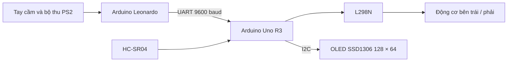

# Xe robot điều khiển bằng tay cầm PS2

Bài tập lớn hệ thống nhúng sử dụng **Arduino Leonardo** và **Arduino Uno R3** để điều khiển xe qua tay cầm PS2. Leonardo đọc lệnh điều khiển rồi gửi qua UART; Uno điều khiển hai kênh động cơ qua L298N, đo khoảng cách bằng HC-SR04 và hiển thị giao diện trên OLED SSD1306.

## Tính năng

- Tiến, lùi, xoay trái/phải bằng D-Pad; thả các nút hướng để dừng.
- Điều chỉnh PWM từ **100–255**, mặc định **200**, mỗi lần nhấn tăng/giảm **25**.
- Ba giao diện OLED: mặt robot có hoạt ảnh, radar minh họa khoảng cách và thông số xe.
- Bốn chế độ biểu cảm: tự động ngủ/thức, vui, ngầu và ngạc nhiên.
- Uno ngắt PWM khi không nhận gói UART trong hơn **500 ms**.

**Phạm vi hiện tại:** cảm biến chỉ phục vụ hiển thị/cảnh báo, chưa tự động dừng hoặc tránh vật cản. Radar là hiệu ứng đồ họa từ một cảm biến cố định, không phải bản đồ quét nhiều hướng. Timeout UART không bảo đảm phát hiện mất sóng tay cầm nếu Leonardo vẫn tiếp tục gửi gói.

## Kiến trúc



## Phần cứng và nối dây

Các thành phần chính: Uno R3, Leonardo, tay cầm PS2 và bộ thu tương thích PS2X, driver L298N, động cơ DC/khung xe, HC-SR04, OLED SSD1306 I2C 128 × 64, nguồn phù hợp và dây nối.

Các bảng dưới đây khớp với `src/uno_r3.cpp` và `src/uno_leo.cpp`.

### Bộ thu PS2 → Leonardo

| Tín hiệu bộ thu | Chân Leonardo |
| --- | --- |
| DAT / DATA | D12 |
| CMD | D11 |
| SEL / ATT | D10 |
| CLK | D13 |
| GND | GND chung |
| VCC | Nguồn đúng thông số bộ thu |

### L298N → Uno R3

| Chân L298N | Chân Uno / kết nối |
| --- | --- |
| ENA | D5 (PWM) |
| IN1 | D7 |
| IN2 | D8 |
| IN3 | D9 |
| IN4 | D10 |
| ENB | D6 (PWM) |
| OUT1, OUT2 | Nhóm động cơ kênh A |
| OUT3, OUT4 | Nhóm động cơ kênh B |
| GND | GND chung |

Tháo jumper **ENA và ENB** khi điều khiển PWM từ Uno. Hai kênh cần bố trí tương ứng với hai bên xe; chiều quay thực tế phụ thuộc cách nối dây động cơ.

### Cảm biến, OLED và UART

| Kết nối | Chân tương ứng |
| --- | --- |
| HC-SR04 TRIG → Uno | D2 |
| HC-SR04 ECHO → Uno | D3 |
| OLED SDA → Uno | A4 / SDA |
| OLED SCL → Uno | A5 / SCL |
| Leonardo TX1 → Uno RX | D1 → D0 |
| GND các module và hai board | Nối chung GND |

OLED được cấu hình địa chỉ **`0x3C`**, xoay **180°** (`XOAY_MAN_HINH = 2`). Đổi thành `0` nếu cần chiều hiển thị chuẩn. Cấp nguồn cho cảm biến, OLED và bộ thu theo thông số module thực tế; nguồn động cơ đi qua driver, không lấy từ chân nguồn Arduino. Jumper nguồn logic `5V-EN` trên L298N khác với jumper ENA/ENB.

UART hiện truyền một chiều từ Leonardo sang Uno, không cần nối đường TX Uno về RX Leonardo.

## Cấu trúc dự án

```text
.
├── src/
│   ├── uno_r3.cpp       # Động cơ, UART, HC-SR04 và giao diện OLED
│   └── uno_leo.cpp      # Đọc PS2 và gửi lệnh UART
├── platformio.ini      # Hai môi trường build: uno và leonardo
├── include/            # Thư mục header, hiện có README mẫu
├── lib/                # Thư viện riêng, hiện có README mẫu
├── test/               # Hiện chỉ có hướng dẫn test mẫu
├── mach.md             # Tài liệu phiên bản cũ
├── note.txt            # Ghi chú nối dây phiên bản cũ
├── main.cpp            # Đoạn mã thử ngoài src/, không tham gia build
└── README.md
```

**Lưu ý:** `mach.md` và `note.txt` chưa đồng bộ với firmware hiện tại. Không sử dụng sơ đồ chân hoặc thao tác điều khiển trong hai tệp này cho phiên bản hiện tại; đối chiếu README và mã nguồn trong `src/`.

## Cài đặt, biên dịch và nạp

Sử dụng **PlatformIO Core** hoặc **VS Code với PlatformIO IDE**. Mở thư mục dự án chứa `platformio.ini`; nếu dùng VS Code, chạy các lệnh dưới đây trong terminal PlatformIO.

PlatformIO quản lý nền tảng `atmelavr`, Arduino framework và các thư viện khai báo trong cấu hình:

- `Adafruit SSD1306` và `Adafruit GFX Library` cho OLED.
- `Arduino-PS2X` cho tay cầm PS2.

Lần build đầu cần Internet để tải công cụ và thư viện; thư viện PS2X khai báo từ GitHub cần Git trong môi trường cài đặt.

### Biên dịch

```powershell
pio run -e uno
pio run -e leonardo
```

Mỗi môi trường chỉ biên dịch tệp tương ứng nhờ `build_src_filter`. Lệnh `pio run` sẽ build cả hai môi trường.

### Nạp firmware

Cắm USB đúng board và nạp lần lượt:

```powershell
pio run -e uno -t upload
pio run -e leonardo -t upload
```

Nếu máy kết nối nhiều board, xem cổng và chỉ định cổng tương ứng (thay `COM3`/`COM4` bằng cổng thực tế):

```powershell
pio device list
pio run -e uno -t upload --upload-port COM3
pio run -e leonardo -t upload --upload-port COM4
```

Ngắt đường **Leonardo TX1 → Uno RX/D0** khi nạp Uno để tránh xung đột với UART USB, sau đó nối lại để vận hành. Firmware hiện không in log debug qua USB; thông số kết nối xem trên giao diện INFO của OLED.

## Sử dụng tay cầm

| Thao tác | Chức năng |
| --- | --- |
| Giữ D-Pad ↑ / ↓ | Tiến / lùi |
| Giữ D-Pad ← / → | Xoay trái / phải bằng hai kênh quay ngược chiều |
| Thả các nút D-Pad | Dừng, đặt PWM đầu ra động cơ về 0 |
| Nhấn R1 | Tăng PWM 25, tối đa 255 |
| Nhấn L1 | Giảm PWM 25, tối thiểu 100 |
| Nhấn SELECT | Chuyển giữa INFO và mặt robot |
| Nhấn START | Chuyển giữa radar và mặt robot |
| Nhấn ○ (CIRCLE) | Về mặt robot và chuyển biểu cảm tuần tự |

Biểu cảm chuyển theo thứ tự **Tự động → Vui → Ngầu → Ngạc nhiên → Tự động**. Ở chế độ tự động, robot ngủ khi lệnh hướng là `S` và thức khi có lệnh di chuyển.

Nếu giữ nhiều nút hướng, code ưu tiên theo thứ tự **lên, xuống, trái, phải**. Phiên bản này không dùng cần analog hoặc yêu cầu giữ L1 để chạy. PWM là mức điều khiển, không phải tốc độ thực đo của động cơ.

## Giao thức UART

Leonardo dùng `Serial1`, Uno dùng `Serial`, cùng tốc độ **9600 baud**. Leonardo gửi theo chu kỳ mục tiêu **40 ms**:

```text
<HUONG,PWM,MODE,EXPR>
```

| Trường | Giá trị |
| --- | --- |
| `HUONG` | `F`: tiến, `B`: lùi, `L`: trái, `R`: phải, `S`: dừng |
| `PWM` | Leonardo gửi 100–255; Uno giới hạn giá trị nhận trong 0–255 |
| `MODE` | `0`: mặt robot, `1`: radar, `2`: INFO |
| `EXPR` | `0`: tự động, `1`: vui, `2`: ngầu, `3`: ngạc nhiên |

Ví dụ `<F,200,0,0>` yêu cầu đi tiến ở PWM 200, hiển thị mặt robot tự động. Leonardo thêm ký tự xuống dòng sau gói; Uno xử lý phần nằm giữa `<` và `>`.

Giao thức hiện chưa có checksum hoặc xác nhận phản hồi và chưa kiểm tra đầy đủ tính hợp lệ của từng trường.

## Kiểm tra vận hành

1. Kiểm tra dây và nguồn; nâng bánh xe khỏi mặt đất trước khi thử điều khiển.
2. Nạp đúng firmware cho từng board, nối UART và GND chung, bật tay cầm.
3. Nhấn SELECT để xem INFO; kiểm tra `UART LEO: KET NOI OK` và PWM mặc định 200.
4. Thử từng hướng, thả nút để dừng; thử R1/L1 và chuyển các giao diện.
5. Đưa vật trước HC-SR04 để quan sát khoảng cách. Dòng `STOP!` trên radar chỉ là cảnh báo hiển thị, không ngắt động cơ.
6. Ngắt dây UART trong điều kiện thử an toàn; Uno phải ngắt PWM sau khi quá timeout 500 ms, cộng thời gian xử lý vòng lặp.

Hiện thư mục `test/` chưa có bài kiểm thử tự động. Cần kiểm tra thực tế khả năng dừng khi mất sóng PS2: code chưa xử lý giá trị trả về của `read_gamepad()` trong vòng lặp.

## Xử lý sự cố

| Hiện tượng | Kiểm tra |
| --- | --- |
| OLED không hiển thị | Nguồn, SDA/SCL, loại màn hình và địa chỉ `0x3C`; Uno dừng trong `setup()` nếu khởi tạo OLED thất bại |
| Xe không nhận điều khiển | Chân bộ thu PS2 trên Leonardo, kết nối tay cầm, TX1/D1 → RX/D0 và GND chung |
| INFO báo mất tín hiệu | Firmware hai board, đường UART và baud rate; Leonardo không gửi gói khi cấu hình PS2 chưa thành công |
| Động cơ không quay | Nguồn motor/logic driver, jumper ENA/ENB, dây điều khiển và PWM |
| Xe đi ngược hướng | Tắt nguồn, kiểm tra lại cực động cơ và cách bố trí kênh A/B |
| Nạp Uno thất bại | Đúng cổng USB, đóng ứng dụng đang giữ cổng và ngắt đường TX Leonardo tới RX Uno |
| Khoảng cách hiện `---` hoặc `> 250 cm` | Vật ngoài dải hiển thị hoặc không nhận được echo; code dùng giá trị 999 khi đo timeout |

## Giấy phép

Dự án hiện chưa có tệp `LICENSE`. Các thư viện phụ thuộc tuân theo giấy phép riêng của từng thư viện.
